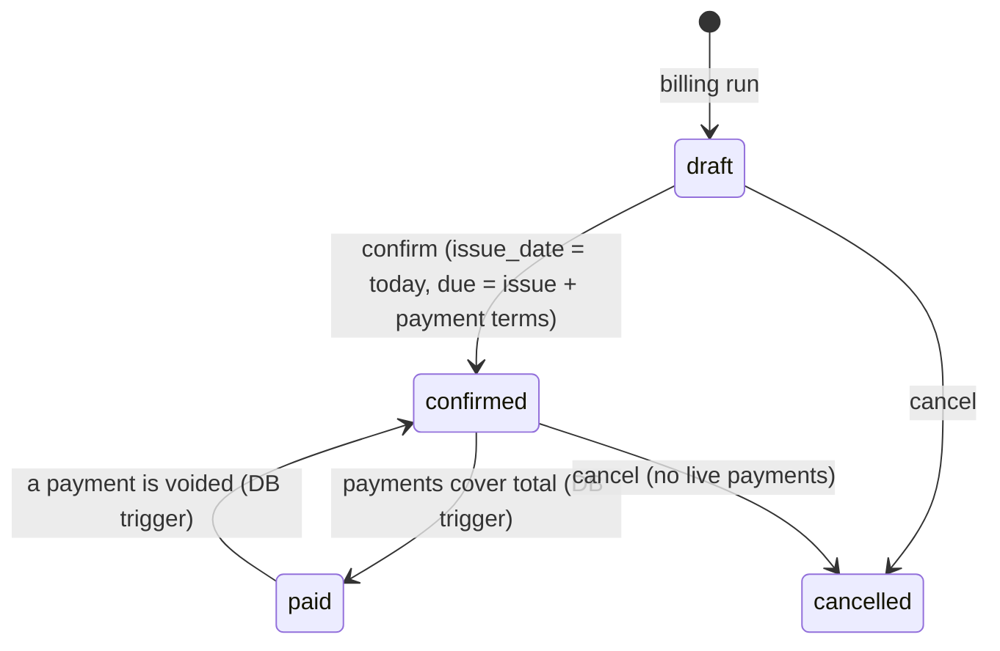

# Backend architecture

How the FastAPI backend works, written from the code. The API contract is `contract/openapi.yaml` + `contract/API.md`;
the schema is `database/` (deployed on Supabase, never changed from backend work). Rules for contributors: `CLAUDE.md`.

## 1. Request flow

```
HTTP request
  -> CORS middleware                              app/main.py
  -> router (parse + validate, call ONE service)  app/routers/*.py
       Depends(get_db)           one SQLAlchemy Session per request           core/deps.py
       Depends(CurrentUser)      Bearer JWT -> User row (401 / 403)           core/deps.py
       Depends(require_roles())  role check from the operation's x-roles      core/deps.py
       Pydantic body/query       bad input -> 400 VALIDATION_ERROR            schemas/*.py
  -> service (ALL business logic, owns the transaction)   app/services/*.py
       reads SQLAlchemy models / views, raises AppError, commits
  -> response_model (CamelModel, Money as "560.00")        schemas/*.py
  -> JSON, or on error {"error": {"code", "message", "details?"}}          core/errors.py
```

- **Routers are thin**: they parse, call a service, return. No rules live there.
- **Services commit.** The session is created in `get_db` and closed after the request, which rolls back anything a
  service did not commit. A service that raises `AppError` therefore leaves nothing behind.
- **Errors** are always `AppError(code, message, details)` raised from services/deps and rendered by one handler
  (`400 VALIDATION_ERROR`, `401 UNAUTHENTICATED`, `403 FORBIDDEN`, `404 NOT_FOUND`, `409 CONFLICT`,
  `422 BUSINESS_RULE`, `500 INTERNAL`). FastAPI's own validation and HTTP errors are mapped to the same shape.
- **Lists** use `core/pagination.py`: `page`, `limit` (max 100), `{data, meta: {page, limit, total, totalPages}}`.
- **Models** (`app/models/`) map the *existing* tables. There is no `create_all` and no Alembic autogenerate.
- **Engine** (`app/db.py`): psycopg 3 with `prepare_threshold=None` and `pool_pre_ping=True`, because the Supabase
  pooler cannot hold server-side prepared statements. `expire_on_commit=False`, `autoflush=False`: services call
  `flush()` explicitly when they need generated values.
- **Derived values come from views**, not code: `v_subscriptions` (subtotal / taxTotal / total), `v_invoices`
  (amountDue, isOverdue), `v_discounts` (status).

## 2. RBAC

Roles are `admin`, `staff`, `customer`. Two layers, both in code:

1. **Route level**: `require_roles("admin", "staff")` mirrors the `x-roles` list of each operation. Wrong role -> 403.
   Admin-only: void a payment, `POST /billing/auto-close`. Staff and admin: billing, confirm/cancel/send invoices,
   record payments, subscription lifecycle except where the plan flags allow the customer (close, pause, resume, renew).
2. **Row level**: services receive the `User` and scope queries. A customer only sees rows with
   `customer_id == user.customer_id`; someone else's record is **404, not 403** (so ids cannot be probed).
   Customers also never see **draft invoices** (404 on detail, absent from lists).

Plan flags (`allowEarlyClose`, `allowPause`, `allowRenew`) are business rules (422), not roles, and apply to
everyone including staff.

## 3. Subscription state machine

`status` has exactly five values. *Paused* is a flag (`is_paused`), not a status.

```mermaid
stateDiagram-v2
    [*] --> draft: POST /subscriptions
    draft --> quotation: send-quotation (needs plan, dates, terms, 1+ line)
    quotation --> confirmed: confirm (plan + quantity + dates re-checked)
    confirmed --> active: activate (re-checked; next_billing_date = start_date)
    active --> closed: close (plan.allowEarlyClose)
    active --> closed: auto-close job (expiry_date passed, plan.autoClose)
    closed --> [*]: final
    active --> active: pause / resume (is_paused flag)
    active --> active: renew (expiry_date moves, plan.allowRenew)
```



- Each step is its own endpoint; anything else is **409**. `draft`/`quotation` are editable; from `confirmed` lines
  and totals are locked.
- Every status change, pause, resume and renew writes `subscription_status_history` in the same transaction. Transitions
  lock the row (`SELECT ... FOR UPDATE`) first. The auto-close job writes `changed_by = NULL` (an automatic change).
- Closing clears `next_billing_date` and `is_paused`. `resume` requires `active` and sets
  `next_billing_date = max(next_billing_date, today)`, so paused time is never billed and nothing is caught up.

Invoices have their own machine:



`PATCH` works on drafts only. `cancel` rewinds the subscription's `next_billing_date` to the invoice's `period_start`
only when it is the subscription's latest live invoice. A cancelled invoice never comes back (trigger).

## 4. Pricing engine (`services/pricing.py`)

Pure functions plus two loaders, shared by subscriptions, the billing run and draft corrections.

1. **Unit price** = `product.sales_price + variant.extra_price`, unless the caller overrides it. Line `amount` =
   `quantity * unit_price`.
2. **Tax pick** (`pick_tax`): active taxes whose `appliesToProductTypes` contains the product type; a tax with no types
   applies to every type. A type-specific tax beats an all-types one; ties go to the oldest tax. Subscription lines
   *snapshot* the tax (id, name, rate); invoices reuse that snapshot rate and look up only whether it is `percentage` or
   `fixed`.
3. **Tax math** (`compute_tax`): percentage = `amount * rate / 100`; fixed = `rate` per line. Charged on the
   **discounted** amount.
4. **Discount selection** (`pick_discounts`), per invoice, evaluated at the period start:
   - eligible: active, `startDate <= periodStart <= endDate`, `usedCount < usageLimit`;
   - `scope=products`: only lines of the linked products; `minQuantity` / `minPurchaseAmount` against that **line**;
   - `scope=subscriptions`: link rows limit it to those subscriptions, **no rows = all**; the minimums are checked
     against total quantity and the subscription subtotal;
   - **one discount per line, the largest amount wins**; a tie goes to the oldest rule;
   - a *fixed* subscription-scope discount is split over the lines in proportion to their amounts, the rounding
     remainder on the last line; a fixed product-scope discount applies once per matching line; no discount exceeds its line.
5. **Rounding**: `money()` is round-half-up to 2 decimals, applied per line. Money is a `Decimal` internally and a
   `"560.00"` string on the wire; never a float.
6. **Totals**: `subtotal = sum(quantity * unit_price)`, `total = subtotal - discountTotal + taxTotal`.
   `plan.price` is a display list price and is **never** added.

Discount usage is a ledger: the service inserts/releases `discount_usages` rows (`sync_discount_usages`) and the DB
trigger keeps `discounts.used_count`. Re-pricing a draft keeps a discount the invoice already holds even at its limit.

## 5. Billing run (`services/billing_service.py`)

`POST /billing/run {asOf, subscriptionIds, dryRun}`:

1. **Candidates**: `status = active`, `is_paused = false`, `next_billing_date <= asOf` and
   `next_billing_date < expiry_date` (a period must start strictly before expiry, so a 12-month monthly plan gets 12
   invoices). `subscriptionIds` narrows the set.
2. A real run first inserts a `billing_runs` row (invoices reference it); a **dry run stores nothing**: it runs the
   same code and rolls back, so what it reports is exactly what a real run would create.
3. **One transaction per subscription**: `SELECT ... FOR UPDATE SKIP LOCKED`, re-check, then one draft invoice per
   missed period in a loop. Any error rolls back that subscription only and is listed in `failed`; the others go on.
   A subscription skipped by `SKIP LOCKED` is reported in `failed` too, so no due subscription disappears from the counts.
4. **Anchored periods** (`services/periods.py`): the next period start is `next_period_start(period_start, billing_period,
   start_date)`. Monthly/yearly starts keep the subscription's start day of month, clamped in short months (31 Jan ->
   28 Feb -> 31 Mar), instead of drifting. Period end = next start - 1 day. `next_billing_date` advances one period per invoice.
5. **Idempotency**: the partial unique index `uq_invoices_subscription_period (subscription_id, period_start) WHERE
   status <> 'cancelled'` makes double billing impossible. Each invoice insert runs in a savepoint; a violation of
   *that* index is counted as `alreadyBilled` (not `failed`) and the date moves on. A cancelled invoice releases its key.
6. Each invoice: lines priced by section 4 (discount rows locked `FOR UPDATE`, so two runs cannot both spend the last use),
   customer snapshot filled by trigger, `discount_usages` inserted. The run row gets counts and `failures` (jsonb).

`GET /billing/due` previews the same candidates and hides ones whose current period already has a live invoice.
The daily job order is **billing run, then auto-close** (closing clears the billing date).

## 6. What the database owns (never written by code)

| Field | Maintained by | Why |
|---|---|---|
| `invoices.amount_paid`, and the `confirmed <-> paid` status flip | `trg_payments_sync_invoice` (sums non-voided payments, locks the invoice row) | One place decides, in the same transaction as the payment, so concurrent payments cannot corrupt the balance. |
| `discounts.used_count` | `trg_discount_usages_sync` from `discount_usages` insert / `released_at` | A CHECK (`used_count <= usage_limit`) is the hard stop against over-use even if two runs race. |
| `payments.is_voided` | generated column from `voided_at` | Void by setting `voided_at` / `voided_by`; rows stay for audit. |
| `subscriptions.number`, `invoices.number` | column default `next_document_number()` | Gap-free, race-safe numbering (`SUB-0001`, `INV-2026-0001`). |
| `invoices.billing_*` snapshot | `trg_invoices_billing_snapshot` on insert | Customer edits never rewrite an issued invoice. |
| `*_lines.amount` | generated columns | `quantity * unit_price (- discount_amount)` can never drift from its parts. |
| `updated_at` | `trg_*_updated_at` | |
| released discount usage on cancel; blocking an un-cancel; immutable payments | triggers / constraints | Invariants that must hold for every writer, not only this API. |

Derived values (`amountDue`, `isOverdue`, subscription totals, discount status) are read from views, so they cannot
disagree with the stored rows. Constraints that back the rules: `invoices_total_ck`, `invoices_not_overpaid_ck`,
`invoices_paid_ck`, `invoices_cancel_ck`, `subscriptions_complete_ck`.
